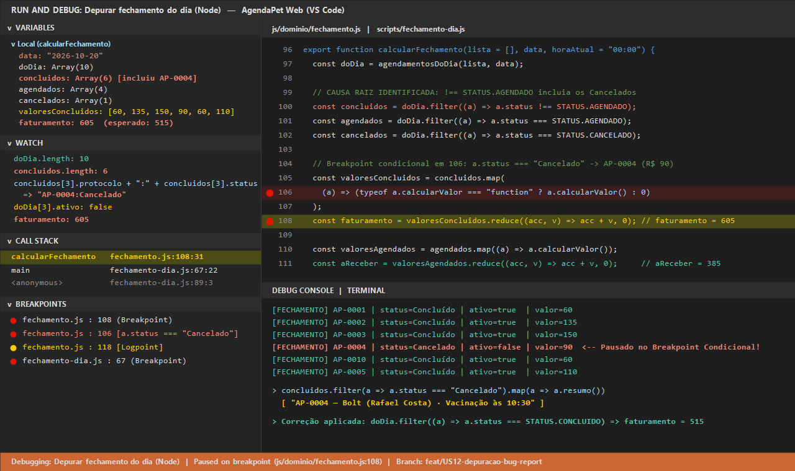
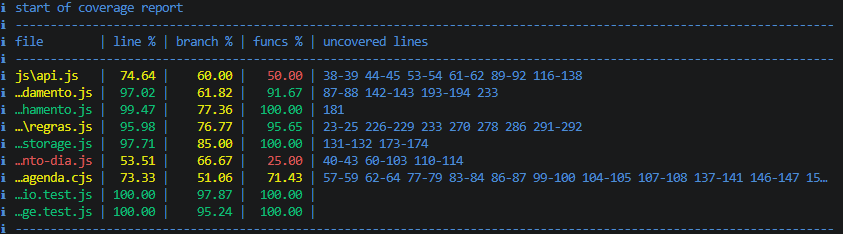

# AgendaPet Web — Patinhas & Cia

Painel web responsivo e acessível para a gestão de agendamentos diários do pet shop Patinhas & Cia, desenvolvido com HTML5 semântico, CSS3 (mobile-first com Flexbox) e JavaScript puro (ESM no front-end e módulos Node.js no back-end).

## Funcionalidades Implementadas

- **US01 — Estrutura Semântica e Acessível:** Landmarks semânticos (`header`, `nav`, `main`, `section`, `aside`, `footer`), formulário com labels associados e contrastes adequados (WCAG AA).
- **US02 — Catálogo de Serviços:** Carregamento assíncrono via `fetch` a partir de `data/servicos.json`, com tratamento dos três estados visuais (carregando, sucesso e erro com botão "Tentar novamente").
- **US03 — Formulário de Novo Agendamento:**
  - Campos: tutor, telefone com DDD, pet, espécie, serviço, data, horário comercial e observações.
  - Validação completa com JavaScript no evento `submit` (com `preventDefault`): campos obrigatórios, telefone válido, data não passada e horário dentro do funcionamento.
  - Acessibilidade: mensagens de erro visíveis na tela anunciadas com `role="alert"` e `aria-live="polite"`, movendo o foco para o primeiro campo inválido (sem uso de `alert()`).
  - Ao salvar com sucesso: exibe feedback de confirmação, limpa o formulário e inclui o agendamento imediatamente na lista da agenda.
- **US04 — Endereço Automático por CEP (ViaCEP):**
  - Exibição condicional dos campos de endereço apenas para serviços que aceitam atendimento domiciliar.
  - Consulta automática à API ViaCEP (`https://viacep.com.br/ws/{cep}/json/`) ao digitar 8 dígitos numéricos (com ou sem hífen).
  - Preenchimento automático de logradouro, bairro, cidade e UF, posicionando o foco diretamente no campo número.
  - Tratamento com mensagens específicas para formato inválido, CEP não encontrado e indisponibilidade de rede.
  - Garantia de preenchimento manual completo do endereço caso a API esteja fora do ar.
- **US05 — Alerta de Feriados com Cache (BrasilAPI):**
  - Consulta de feriados nacionais na BrasilAPI (`https://brasilapi.com.br/api/feriados/v1/{ano}`) ao selecionar a data.
  - Cache no `localStorage` com registro de data da consulta e validade de 30 dias para evitar requisições repetidas.
  - Exibição do nome do feriado e bloqueio do salvamento sem a marcação explícita de "Agendar mesmo assim".
  - Resiliência: caso a API de feriados falhe, um aviso é emitido e o sistema permite continuar o agendamento normalmente.
- **US06 — Agenda do Dia (Lista, Busca, Filtros e Atalhos):**
  - Renderização dinâmica e segura via DOM (`createElement`, `textContent`, `classList`) sem uso de `innerHTML`.
  - Ordenação automática dos agendamentos do dia por horário e status (Agendado, Concluído, Cancelado).
  - Interação com mouse: botões para concluir e cancelar atendimentos, efeito hover e destaque com realce ao selecionar itens.
  - Busca em tempo real por tutor ou pet via eventos `input` e `keyup`.
  - Atalhos globais de teclado: `N` para focar no primeiro campo do formulário, `/` para focar e selecionar a busca, e `Esc` para limpar a busca.
  - Acessibilidade total por teclado com `Tab`, `Enter` e `Espaço` em todos os controles interativos.
  - Filtro por status (`todos`, `Agendado`, `Concluído`, `Cancelado`), contador dinâmico de agendamentos e mensagem dedicada para lista vazia.
- **US07 — Regras de Negócio, POO e Fechamento do Dia:**
  - **Programação Orientada a Objetos (POO):** Classe base `Agendamento` e subclasse especializada `AgendamentoDomiciliar extends Agendamento`, com construtores, atributos (`endereco` no domiciliar), getters (`ativo`, `inicio`, `tipo`) e sobrescrita polimórfica de métodos (`calcularValor()` e `resumo()`). Uso significativo da palavra-chave `this` para vinculação de instância.
  - **Prevenção de conflitos de agenda:** Método `conflitaCom(outro)` e função `temConflito(lista, novo)` impedindo agendamentos ativos simultâneos na mesma data e horário. Cancelamentos liberam o horário automaticamente.
  - **Protocolo sequencial sem variáveis globais:** Implementação de gerador via closure (`criarGeradorProtocolo(ultimo)`), preservando o contador de forma privada no escopo léxico da função.
  - **Função de alta ordem com callbacks:** `filtrarAgendamentos(lista, ...criterios)` recebe funções callback independentes (`porStatus`, `porBusca` ou predicados customizados) combinadas por meio de `every()`.
  - **Fechamento consolidado do dia:** Cálculo de total de atendimentos, faturamento dos concluídos, valores a receber dos agendados, cancelados, agrupamento por serviço e próximo atendimento do dia. Utiliza métodos de array (`map`, `filter`, `find`, `every`, `some`, `reduce`, `sort`) e laços (`for...of`).
  - **Atualização em tempo real na interface:** Renderização automática dos cartões de fechamento e da tabela de atendimentos por serviço, além do banner de próximo atendimento.
- **US08 — Persistência e Exportação dos Dados:**
  - **Isolamento de persistência em `js/storage.js`:** Acesso centralizado ao `localStorage` com prefixo delimitador (`agendapet:`), garantindo que outras aplicações no mesmo domínio não sejam afetadas.
  - **Tratamento robusto de erros com `try/catch`:** Tratamento para dados corrompidos ou sintaxe JSON inválida em `lerJSON()`, retornando valores padrão seguros sem interromper o funcionamento da aplicação. Tratamento de exceções em `salvarJSON()` (como estouro de cota `QuotaExceededError`).
  - **Persistência de agendamentos, filtros e preferências:**
    - Agenda persistida automaticamente a cada criação, alteração de status ou exclusão, serializando instâncias de classes com `paraJSON()`.
    - Filtro de status ativo restaurado automaticamente ao recarregar a página.
    - Preferência de interface (tema claro / escuro com atributo `data-tema`) persistida e reaplicada no carregamento inicial da página.
  - **Botão "Limpar meus dados":** Exclui exclusivamente as chaves da aplicação (`agendapet:*`), mantendo os dados de outros sistemas intactos e preservando a escolha de tema do usuário.
  - **Exportação e utilitários:**
    - Botão "Exportar dados": renderiza o JSON estruturado e identado (2 espaços), exatamente no mesmo esquema de dados consumido pelos scripts Node.js (US11).
    - Botão "Copiar": transfere o conteúdo do JSON para a área de transferência usando a API Clipboard ou fallback.
    - Botão "Baixar JSON" (Bônus): gera e baixa o arquivo `agenda-AAAA-MM-DD.json` localmente via Blob e Object URL.
    - Botão "Carregar exemplo": permite importar instantaneamente os dados de `data/agenda-exemplo.json` para demonstração e testes.
- **US09 — Relógio e Lembretes de Atendimento (Timers):**
  - **Temporizador periódico com `setInterval`:** Atualização periódica a cada 30 segundos sincronizando o relógio (`.relogio__hora`) e recalculando a agenda do dia.
  - **Destaque automático de atendimentos atrasados:** Identifica agendamentos com horário anterior ao momento atual que ainda estejam com status `Agendado`, aplicando as classes visuais `.item--atrasado` e o selo `.selo--atrasado`.
  - **Cálculo dinâmico do próximo atendimento:** O banner da agenda exibe em tempo real o texto `"Próximo atendimento em X min: ..."` para atendimentos futuros e `"Próximo atendimento agora: ..."` para o atendimento corrente.
  - **Lembrete visual antecipado (15 minutos ou menos):** Exibição dinâmica do banner de alerta `#lembrete` sempre que um agendamento do dia estiver a 15 minutos ou menos do seu início (`CONFIG.minutoLembrete = 15`), preparando o atendente para a chegada do pet.
  - **Controle de Pausar e Retomar com `clearInterval`:** Botão interativo `#btn-lembretes` permitindo pausar e retomar os lembretes periódicos com atualização dinâmica de estado WAI-ARIA (`aria-pressed`).
  - **Notificações temporárias com `setTimeout` (Toast):** Sistema de toast flutuante com desaparecimento automático após 4 segundos, prevenindo timers acumulados/duplicados através de `clearTimeout` antes de cada novo agendamento.
- **US10 — Layout Responsivo e Identidade Visual (CSS, Flexbox e Especificidade):**
  - **Flexbox como base de layout:** Estruturação integral com Flexbox no cabeçalho (`.topo`, `.topo__marca`, `.topo__ferramentas`, `.nav`), formulário (`.form`, `.linha`, `.campo`, `.endereco`), listas (`.servicos`, `.agenda`, `.item`, `.item__detalhes`), cartões (`.cartao`, `.resumo`, `.resumo__item`) e rodapé (`.rodape`).
  - **Mobile-first e responsividade sem rolagem horizontal:** Folha de estilos base projetada para telas pequenas (validada em **360px**), evoluindo progressivamente com media queries para **tablet (`min-width: 768px`)** e **desktop (`min-width: 1024px` e `min-width: 1280px`)**, garantindo ausência de barra de rolagem horizontal em todas as resoluções.
  - **Design Tokens via Custom Properties (`:root`):** Variáveis CSS padronizadas para **cores** (identidade visual *Patinhas & Cia* em verde-petróleo `#00695c` e âmbar `#ffb300`, além do tema escuro completo `[data-tema="escuro"]`), **espaçamentos** (`--espaco-2xs` a `--espaco-xl`, raios de borda e `--alvo-toque: 44px`) e **tipografia** (famílias `--fonte` e `--fonte-mono`, escala modular `--texto-xs` a `--texto-2xl`, pesos e entrelinhas).
  - **Especificidade sob controle:** Zero ocorrências de `!important`, zero seletores por `#id` na folha de estilos e ausência de atributos `style` inline no HTML, mantendo seletores planos de baixa especificidade (padrão BEM).
  - **Acessibilidade visual e ergonômica:** Estados `:hover` e `:focus-visible` (`outline: 3px solid var(--foco)`) de alta visibilidade, alvos de toque confortáveis (mínimo de `44px` de altura) e relação de contraste de texto superior a **4,5:1** (WCAG AA) em todos os componentes.
- **US11 — Projeto Node.js, Relatório de Fechamento e Validação de Dados (ESM e CommonJS):**
  - **Manifesto `package.json`:** Configurado com `name`, `version`, `description`, `"type": "module"`, scripts `start`, `fechamento`, `validar`, `validar:erro` e `test`, e dependência local `http-server` em `devDependencies`.
  - **Controle de versão de dependências:** `package-lock.json` versionado no Git para reprodutibilidade exata e pasta `node_modules/` ignorada no `.gitignore`.
  - **Script de Fechamento em ESM (`scripts/fechamento-dia.js`):** Importa os mesmos módulos de domínio (`js/dominio/agendamento.js`, `js/dominio/regras.js` e `js/dominio/fechamento.js`) usados pelo navegador, lê `data/servicos.json` e `data/agenda-exemplo.json` (ou `--arquivo=...` e `--data=...`) e imprime o relatório completo do caixa no terminal.
  - **Script de Validação em CommonJS (`scripts/validar-agenda.cjs`):** Usa `require('node:fs')`, `require('node:path')`, `__dirname` e `import()` dinâmico para validar a integridade de arquivos JSON de agenda (campos obrigatórios, protocolos únicos, status, data, horário comercial, regras domiciliares e conflitos de horário), encerrando com `process.exit(1)` quando encontra inconsistências.
- **US12 — Depuração no VS Code e Relatório de Bug:**
  - **Configuração do depurador (`.vscode/launch.json`):** Perfis prontos para depurar `scripts/fechamento-dia.js` (ESM), `scripts/validar-agenda.cjs` (CommonJS), `tests/dominio.test.js` (Node Test Runner) e a interface web no navegador (Edge / Chrome).
  - **Investigação com Breakpoints, Watch e Call Stack:** Uso de breakpoints simples, breakpoint condicional (`a.status === 'Cancelado'`) e logpoint em `js/dominio/fechamento.js` para isolar e corrigir a causa raiz na apuração de faturamento.
  - **Relatório de Bug documentado (`docs/bug-report.md` e `docs/depuracao.png`):** Registro completo com passos de reprodução, tabela esperado × obtido, inspeção de variáveis/Watch, Call Stack, código antes/depois e prevenção via testes automatizados.

---

## Depuração no VS Code e Relatório de Bug (US12)

O arquivo `.vscode/launch.json` disponibiliza 5 configurações de depuração acionáveis com **F5**:
1. **Depurar fechamento do dia (Node):** Executa `scripts/fechamento-dia.js --data=2026-10-20`.
2. **Depurar validar-agenda (CommonJS):** Executa `scripts/validar-agenda.cjs data/agenda-invalida.json`.
3. **Depurar testes do domínio (Node):** Executa `tests/dominio.test.js`.
4. **Depurar a página (Edge / Chrome):** Abre `http://localhost:5500` conectado ao depurador do VS Code.

- **Relatório completo do defeito investigado:** Consulte [docs/bug-report.md](docs/bug-report.md).
- **Evidência da sessão de depuração:**



- **Evidência do coverage:**



---

## Projeto Node.js, Gerenciamento de Pacotes (npm) e Módulos (US11)

### 1. Instalação Global vs. Instalação Local no npm

No ecossistema Node.js, pacotes podem ser instalados em dois escopos distintos:

#### A) Instalação Local (`npm install` / `npm install --save-dev`)
- **Quando usar:** Sempre que o pacote for uma dependência do projeto (bibliotecas de código, servidores de desenvolvimento como `http-server` ou `live-server`, executores de teste, linters).
- **Por que usar:** Garante que a dependência fique registrada no `package.json` e travada no `package-lock.json`. Qualquer pessoa que clonar o repositório e executar `npm install` terá exatamente a mesma versão instalada dentro de `./node_modules`, sem conflitos entre projetos diferentes na mesma máquina.
- **O que instalamos localmente neste projeto:** Instalamos o pacote **`http-server` (`^14.1.1`) localmente** como dependência de desenvolvimento (`devDependencies` no `package.json`), utilizado pelo script `"start": "http-server . -p 5500 -c-1 -o"`.

#### B) Instalação Global (`npm install -g`)
- **Quando usar:** Apenas para ferramentas de linha de comando (CLI) de uso geral do sistema operacional que não pertencem a um repositório específico (como o próprio `npm`, gerenciadores de versão ou geradores de projetos globais).
- **Por que evitar para dependências de projeto:** Pacotes globais não ficam registrados no `package.json`. Se um projeto dependesse de um pacote global, outro desenvolvedor ao clonar o repositório receberia erro de *"comando não encontrado"*.
- **O que instalamos globalmente neste projeto:** **Nada** foi exigido globalmente para rodar o AgendaPet Web; toda a infraestrutura do projeto é autocontida localmente.

#### C) Comandos Essenciais de Gerenciamento e Inspeção (`npm` e `npx`)

```bash
# Instalar uma dependência de desenvolvimento localmente no projeto (grava em devDependencies)
npm install --save-dev http-server

# Instalar um utilitário globalmente no sistema operacional
npm install -g http-server

# Listar a árvore de pacotes instalados LOCALMENTE no projeto atual
npm ls

# Listar apenas os pacotes de 1º nível instalados GLOBALMENTE na máquina
npm ls -g --depth=0

# Executar o binário instalado localmente em ./node_modules/.bin sem instalar globalmente
npx http-server . -p 5500 -c-1
```

---

### 2. Comparação entre CommonJS (CJS) e ECMAScript Modules (ESM)

| Critério | CommonJS (CJS) | ECMAScript Modules (ESM) |
| :--- | :--- | :--- |
| **Sintaxe de importação / exportação** | `const x = require('...')` / `module.exports = ...` | `import { x } from '...'` / `export ...` |
| **Extensão de arquivo** | `.cjs` (ou `.js` quando `"type": "commonjs"` / omitido) | `.mjs` (ou `.js` quando `"type": "module"`) |
| **Campo `"type"` no `package.json`** | `"commonjs"` (valor padrão se omitido no `package.json`) | `"module"` |
| **Modo de carregamento** | **Síncrono** e resolvido dinamicamente em tempo de execução | **Assíncrono** e analisado estaticamente antes da execução |
| **Variáveis de diretório** | Possui `__dirname` e `__filename` nativamente | Usa `import.meta.url` (convertido com `fileURLToPath`) |
| **Uso direto no navegador** | **Não suportado nativamente** (exige *bundlers* como Webpack) | **Nativo** nos navegadores modernos via `<script type="module">` |

#### Justificativa da Escolha Arquitetural no Projeto
1. **Por que adotamos ESM (`"type": "module"`) como padrão do projeto?**
   O requisito central da arquitetura do AgendaPet Web é compartilhar **exatamente os mesmos módulos de regras de negócio (`js/dominio/`)** entre o navegador (`index.html` carregando `<script type="module" src="js/app.js">`) e o terminal Node.js (`scripts/fechamento-dia.js` e `tests/`), **sem uso de bundlers ou transpiladores**. Como o navegador suporta nativamente apenas a sintaxe `import`/`export` (ESM), configurar `"type": "module"` no `package.json` permite que o Node.js execute os mesmos arquivos `.js` diretamente.
2. **Por que usamos `.cjs` em `scripts/validar-agenda.cjs`?**
   Para demonstrar na prática a coexistência e interoperabilidade entre os dois padrões no Node.js. A extensão `.cjs` instrui o Node.js a tratar aquele script específico como **CommonJS** (permitindo usar `require('node:fs')`, `require('node:path')` e `__dirname`), enquanto o carregamento assíncrono `await import('../js/dominio/regras.js')` faz a ponte para reaproveitar os módulos ESM do domínio sem duplicação de código.

---

## Arquitetura CSS, Especificidade e Resolução de Conflitos de Estilo (US10)

### 1. Estratégia Mobile-First e Breakpoints
A folha de estilos (`css/style.css`) foi construída com abordagem **mobile-first**:
- **Base Mobile (`>= 360px`):** Todo o layout empilha verticalmente (`flex-direction: column`), com campos ocupando 100% da largura disponível, alvos de toque mínimos de `44px` (`--alvo-toque`) e proteção contra estouro horizontal (`min-width: 0` em itens flexíveis e `overflow-x: hidden`).
- **Breakpoint 1 — Tablet (`@media (min-width: 768px)`):** O cabeçalho (`.topo`) distribui marca e ferramentas lado a lado, campos agrupados em `.linha` e `.filtros` passam a dividir a mesma fileira horizontal (`flex-direction: row; flex-wrap: wrap`), itens da agenda alinham cabeçalho e selos na mesma linha e os cartões de resumo do fechamento distribuem-se em 3 colunas (`calc(33.333% - var(--espaco-xs))`).
- **Breakpoint 2 — Desktop (`@media (min-width: 1024px)` e `@media (min-width: 1280px)`):** O painel principal (`.painel`) divide-se em duas colunas lado a lado (`coluna--form` à esquerda e `coluna--agenda` à direita com maior proporção flexível), e o cabeçalho alinha marca, ferramentas e navegação em uma única barra horizontal.

### 2. Controle de Especificidade (Sem `!important` e Sem `#id`)
Para evitar "guerras de especificidade", adotamos a nomenclatura **BEM (Block, Element, Modifier)**:
- Seletores de classe plana (`.cartao`, `.campo__entrada`, `.botao--principal`) possuem especificidade constante e baixa (`0,1,0`).
- Nenhum seletor utiliza `#id` (`0,1,0,0`) ou `style` inline (`1,0,0,0`), reservando os atributos `id` do HTML exclusivamente para âncoras de acessibilidade (`aria-labelledby`, `aria-describedby`, `for`) e ganchos de manipulação no JavaScript.
- Nenhuma regra utiliza `!important`.

### 3. Conflito de Estilos Encontrado e Como Foi Resolvido

#### Conflito Principal: Atributo HTML `[hidden]` vs. Componentes com `display: flex`
- **O problema:** No HTML semântico da aplicação, diversos contêineres iniciam ocultos através do atributo nativo `hidden` — como o grupo de endereço domiciliar (`<fieldset class="endereco" id="grupo-endereco" hidden>`), o painel de exportação (`<div class="exportacao" id="exportacao" hidden>`) e os banners de feedback (`<div class="status" hidden>`, `<div class="aviso" hidden>`). Por padrão, o navegador (*User-Agent Stylesheet*) aplica `[hidden] { display: none; }` com especificidade mínima. No entanto, ao convertermos todos esses blocos para Flexbox (`.endereco { display: flex; }`, `.exportacao { display: flex; }`, `.status { display: flex; }`), o seletor de classe da nossa folha de estilo (`0,1,0`) **sobrescrevia** o `display: none` nativo do navegador. Como consequência, os blocos que deveriam estar ocultos continuavam visíveis na tela mesmo possuindo o atributo `hidden`.
- **Por que não usar `!important`:** A solução mais comum na web é escrever `[hidden] { display: none !important; }`, mas o uso de `!important` quebra a cascata natural do CSS e viola a diretriz arquitetural do projeto.
- **Como resolvemos com controle de especificidade e cascata:**
  1. Mantivemos todos os seletores de blocos de layout com especificidade de uma única classe (`0,1,0`, como `.endereco`, `.exportacao`, `.status` e `.lembrete`).
  2. Declaramos explicitamente a regra `[hidden] { display: none; }` na **última linha** do arquivo `css/style.css`.
  3. Como um seletor de atributo (`[hidden]`) possui exatamente a **mesma especificidade (`0,1,0`)** que um seletor de classe (`.endereco`), o navegador aplica o critério de desempate da **ordem na cascata**: por vir por último no arquivo, `[hidden] { display: none; }` vence qualquer `display: flex` declarado anteriormente, ocultando os elementos com perfeição sem precisar de `!important` nem de seletores compostos.

#### Segundo Conflito: Sobreposição de estados nos cartões da agenda (`.item`)
- **O problema:** Um item da agenda (`.item`) pode acumular múltiplas classes de estado simultaneamente: status (`.item--concluido` ou `.item--cancelado`), alerta temporal (`.item--atrasado`), detalhes abertos (`.item--expandido`) e interação de ponteiro (`.item:hover`). Todas essas regras disputam as propriedades `border-left-color` e `background`.
- **Como resolvemos:** Em vez de encadear seletores de alta especificidade (como `ul.agenda li.item.item--atrasado`), mantivemos seletores planos (`0,1,0`) e ordenamos a declaração na folha de estilos segundo a prioridade visual de negócio: base (`.item`) → status concluído/cancelado → alerta de atraso (`.item--atrasado`) → estado expandido (`.item--expandido`). Assim, a cascata resolve a precedência de forma limpa e previsível.

---

## Decisões de Negócio e Regras da Loja

### Horário de Funcionamento da Loja (US03)
- **Horário de atendimento:** Das **08:00 às 18:00**.
- **Intervalo de agendamento (passo):** De **30 em 30 minutos** (ex.: 08:00, 08:30, 09:00, etc.).
- **Término do atendimento:** Nenhum serviço pode ultrapassar o horário de encerramento da loja. O horário inicial somado à duração do serviço escolhido (`duracaoMin`) deve terminar até as **18:00**.
- **Datas:** Não é permitido registrar agendamentos em datas passadas. Se a data for hoje, o horário não pode ser anterior ao horário atual.
- **Telefone:** Obrigatório com DDD (10 dígitos para fixo ou 11 dígitos para celular com nono dígito).

### Atendimento Domiciliar e Taxa de Deslocamento (US04, US07)
- **Serviços permitidos:** Apenas serviços com a flag `domiciliar: true` no catálogo podem ser realizados no domicílio do tutor (ex.: Banho e Tosa Completa aceitam; Adestramento é realizado apenas na loja física).
- **Taxa de deslocamento:**
  - Para a cidade sede da loja (**São Paulo**): taxa fixa de **R$ 15,00** adicionada ao valor do serviço.
  - Para as demais cidades: taxa de **R$ 30,00** adicionada ao valor do serviço.
- O cálculo do valor total do atendimento domiciliar é encapsulado pelo método `calcularValor()` da subclasse `AgendamentoDomiciliar`, invocando `super.calcularValor() + this.taxaDeslocamento()`.

### Fechamento Financeiro do Dia (US07)
- **Faturamento realizado:** Considera única e exclusivamente os agendamentos com status **Concluído** (`STATUS.CONCLUIDO`).
- **Valores a receber:** Soma os valores dos atendimentos ainda pendentes com status **Agendado** (`STATUS.AGENDADO`).
- Atendimentos com status **Cancelado** (`STATUS.CANCELADO`) não compõem faturamento nem valores a receber.
- **Próximo atendimento:** Localiza o primeiro atendimento ativo com status `Agendado` a partir do horário atual (`HH:MM`).

---

## Declaração de Variáveis no JavaScript: const, let e var (e por que evitar var)

No JavaScript moderno (ECMAScript 2015 / ES6 em diante), a forma como declaramos identificadores mudou fundamentalmente para garantir previsibilidade, imutabilidade e segurança no controle de escopo.

### 1. `var` (Legado — Evite)
- **Escopo de função (Function Scope):** Variáveis declaradas com `var` não respeitam blocos delimitados por chaves `{ ... }` (como estruturas `if`, `for`, `while` ou `switch`). Elas "vazam" para toda a função onde foram declaradas ou para o escopo global.
- **Hoisting permissivo com `undefined`:** A declaração da variável é içada (*hoisted*) para o topo do seu escopo e imediatamente inicializada com `undefined`. Acessar a variável antes de sua declaração na linha de código não gera erro, mas retorna `undefined`, o que mascara bugs silenciosos.
- **Permite redeclaração:** É possível redeclarar a mesma variável com `var` repetidas vezes no mesmo escopo sem nenhum erro (`var pet = 'Rex'; var pet = 'Thor';`), facilitando sobrescritas acidentais em arquivos extensos.
- **Poluição do escopo global:** Variáveis com `var` declaradas fora de funções no navegador tornam-se propriedades diretas do objeto `window` (`window.pet`), aumentando o risco de conflitos entre bibliotecas e scripts.

### 2. `let` (Moderno — Para variáveis mutáveis)
- **Escopo de bloco (Block Scope):** A variável existe exclusivamente dentro do bloco `{ ... }` em que foi declarada.
- **Hoisting com Zona Morta Temporal (TDZ — *Temporal Dead Zone*):** A variável é içada conceitualmente, mas **não** é inicializada. Tentar acessar uma variável declarada com `let` antes de sua linha de definição lança um erro fatal imediato (`ReferenceError: Cannot access 'nome' before initialization`), tornando a falha explícita.
- **Não permite redeclaração:** Declarar duas vezes a mesma variável com `let` no mesmo escopo causa erro de sintaxe imediato (`SyntaxError: Identifier 'x' has already been declared`).
- **Permite reatribuição:** O valor associado ao identificador pode ser alterado ao longo da execução (`let contador = 0; contador += 1;`).

### 3. `const` (Moderno — Padrão recomendado)
- **Escopo de bloco e TDZ:** Segue rigorosamente as mesmas regras de escopo de bloco e zona morta temporal que `let`.
- **Declaração com inicialização obrigatória:** Não é permitido declarar uma constante sem fornecer seu valor inicial (`const total;` é inválido).
- **Imutabilidade da vinculação (Binding):** O identificador não pode ser reatribuído (`const taxa = 15; taxa = 20;` lança `TypeError: Assignment to constant variable`).
- **Atenção — Imutabilidade da referência vs. Conteúdo do objeto:** `const` impede a reatribuição da referência na memória, mas **não** congela as propriedades de objetos ou elementos de arrays. Um objeto instanciado com `const` pode ter suas propriedades modificadas. Para tornar um objeto imutável de forma profunda, utiliza-se `Object.freeze()`.

### 4. Por que evitar `var`?
1. **Prevenção de vazamento de escopo e bugs em laços:** Em laços `for (var i = 0; i < 3; i++)`, a variável `i` permanece acessível fora do laço. Em operações assíncronas (como callbacks de eventos ou timers), todas as iterações compartilham a mesma referência única de `i`. Com `let`, cada iteração cria uma vinculação de bloco nova e isolada.
2. **Eliminação de bugs silenciosos:** O içamento com inicialização em `undefined` de `var` frequentemente gera lógicas condicionais enganosas onde o código executa com valores indefinidos sem disparar erros. Com `let` e `const`, erros de acesso precoce são detectados imediatamente via `ReferenceError`.
3. **Evita colisões acidentais por redeclaração:** Com `const` e `let`, o compilador/interpretador rejeita duplicidade de declaração no mesmo escopo.
4. **Regra de Ouro (Clean Code em JavaScript Moderno):**
   - Use **`const` por padrão** para todas as declarações (variáveis, funções, classes, referências de objetos e arrays).
   - Use **`let` apenas quando a variável estritamente precisar ser reatribuída** (ex.: contadores em acumuladores, variáveis de controle de fluxo de laços).
   - **Nunca use `var`** em projetos modernos.

---

## Estrutura de Pastas do Projeto

```text
agenda-pet-web/
├── .github/
│   └── pull_request_template.md  # Modelo padrão para descrição de Pull Requests
├── .vscode/
│   └── launch.json               # Configurações de depuração (Node ESM, CommonJS, Testes e Browser)
├── css/
│   └── style.css                 # Folha de estilos mobile-first com Flexbox e Custom Properties
├── data/
│   ├── agenda-exemplo.json       # Massa de agendamentos de exemplo para testes e demonstração
│   ├── agenda-invalida.json      # Massa de agendamentos com erros propositais para o validador
│   └── servicos.json             # Catálogo de serviços, preços, durações e elegibilidade domiciliar
├── docs/
│   ├── bug-report.md             # Relatório detalhado de investigação e correção de bug (US12)
│   └── depuracao.png             # Evidência visual do depurador do VS Code pausado no breakpoint
├── img/
│   ├── favicon.svg               # Ícone da aba do navegador
│   └── logo.svg                  # Logotipo vetorial da Patinhas & Cia
├── js/
│   ├── dominio/                  # Núcleo puro de regras de negócio (compartilhado Web + Node.js)
│   │   ├── agendamento.js        # Classes Servico, Agendamento, AgendamentoDomiciliar e closure de protocolo
│   │   ├── fechamento.js         # Filtros com callbacks, ordenação e cálculo de fechamento diário
│   │   └── regras.js             # Validações de data, horário comercial, telefone, CEP e conflitos
│   ├── api.js                    # Integrações assíncronas com fetch (servicos.json, ViaCEP e BrasilAPI)
│   ├── app.js                    # Ponto de entrada da interface web, eventos de DOM e timers
│   ├── storage.js                # Persistência isolada em localStorage com tratamento try/catch
│   └── ui.js                     # Renderização segura do DOM (createElement / textContent)
├── planejamento/
│   └── sprint-planning.md        # Planejamento da Sprint, estimativas e análise de riscos
├── scripts/
│   ├── fechamento-dia.js         # Script CLI em ESM para relatório de fechamento no terminal
│   └── validar-agenda.cjs        # Script CLI em CommonJS para validação estrutural de arquivos JSON
├── tests/
│   ├── dominio.test.js           # Testes automatizados do domínio e dos scripts CLI (node:test)
│   └── storage.test.js           # Testes automatizados de persistência e cache em localStorage
├── index.html                    # Página única com estrutura HTML5 semântica e acessível
├── package.json                  # Manifesto npm, scripts e devDependencies
└── README.md                     # Documentação geral do projeto
```

---

## Como Rodar

1. **Instale as dependências locais:**
   ```bash
   npm install
   ```

2. **Inicie o servidor local de desenvolvimento:**
   ```bash
   npm start
   ```
   Acesse a aplicação no navegador em `http://localhost:5500`.

3. **Gere o relatório de fechamento do dia no terminal (ESM):**
   ```bash
   npm run fechamento
   # Ou informando data e arquivo customizados:
   node scripts/fechamento-dia.js --data=2026-10-20 --arquivo=data/agenda-exemplo.json
   ```

4. **Valide um arquivo de agenda no terminal (CommonJS):**
   ```bash
   # Valida data/agenda-exemplo.json (esperado: [OK], código de saída 0)
   npm run validar

   # Valida data/agenda-invalida.json (esperado: [ERRO] com lista de problemas, código de saída 1)
   npm run validar:erro
   ```

5. **Execute a suíte de testes automatizados:**
   ```bash
   npm test
   ```

6. **Depure no VS Code (US12):**
   Abra o painel **Run and Debug (`Ctrl+Shift+D`)**, escolha **"Depurar fechamento do dia (Node)"** ou **"Depurar validar-agenda (CommonJS)"** e pressione **F5**.

7. **Execute a cobertura dos testes automatizados:**
   ```bash
   npm run test:coverage
   ```

## Tecnologias

- **HTML5** semântico e acessível (WAI-ARIA).
- **CSS3** estruturado com variáveis CSS (Custom Properties) e layout Flexbox.
- **JavaScript (ES2022+):** Módulos nativos (ESM no navegador e Node.js + interoperabilidade CommonJS `.cjs`).
- **Node.js (>=20):** Scripts de CLI (`fs`, `path`, `url`) e executor nativo de testes (`node:test`).
